# SmartFridge: project guide

A walkthrough of what SmartFridge does, how every screen works, and how the app is put together. It is meant to be read top to bottom: first the app as a user sees it, then the machinery underneath.

> **About the screenshots.** They were captured from the real app running on an Android 15 emulator, with the three backends replaced by local stand-ins: a fake in-memory account and data store instead of Firebase, and local mock servers instead of Spoonacular and OpenAI. That is why you will see names like "Maya Mock" and "Mock Veggie Omelette". The screens, layouts, and behaviour are the app's own; the data is invented. See [How this guide was verified](#how-this-guide-was-verified) for exactly what was and was not tested.

> **Want to try it yourself?** A self-contained demo build with sample data like this is available to download from the [README](../README.md#try-the-demo).

**Contents**

1. [What SmartFridge is](#1-what-smartfridge-is)
2. [A tour of the app](#2-a-tour-of-the-app)
3. [How the app is built](#3-how-the-app-is-built)
4. [Data and external services](#4-data-and-external-services)
5. [Background work and reminders](#5-background-work-and-reminders)
6. [Tech stack](#6-tech-stack)
7. [Project layout](#7-project-layout)
8. [Running it yourself](#8-running-it-yourself)
9. [How this guide was verified](#how-this-guide-was-verified)
10. [Limits and rough edges](#10-limits-and-rough-edges)

---

## 1. What SmartFridge is

SmartFridge is an Android app that connects three things people usually keep in separate places: **what is in their kitchen**, **what they could cook with it**, and **how they are eating and drinking over the day**. It is built in Kotlin with Jetpack Compose and was written as a four-person team project (Team 8).

| You want to... | SmartFridge gives you... |
| --- | --- |
| Know what you have | A pantry you can fill by typing or by pointing the camera at groceries |
| Decide what to cook | Recipe search, plus a "what can I make with this?" match ranked by how few ingredients you are missing |
| Fill the gaps | Substitute suggestions for missing ingredients, and one-tap searches in four delivery apps |
| Stay on track | A daily diary of calories, macros and water against goals taken from your own profile |
| Ask a quick question | A nutrition chatbot, "Sprout", that knows your profile, pantry and today's intake |

Three outside services power it: **Firebase** (accounts and storage), **Spoonacular** (recipes and nutrition data) and **OpenAI** (the chatbot, camera recognition and substitutions).

---

## 2. A tour of the app

The app opens on a sign-in screen. Once you are in, a bottom bar gives you five places: **Home, Recipes, Pantry, Fitness and AI Chat**. Settings is reached from the avatar on Home.

### Sign in

| | |
| --- | --- |
| 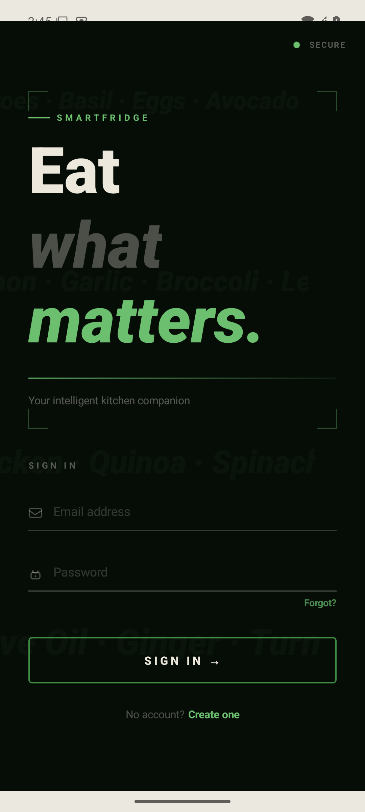 | **What you see.** The headline "Eat what matters.", email and password fields, a **Forgot?** link for password reset, **Sign In**, and **Create one** for a new account.<br><br>**How it works.** Sign-in uses Firebase email and password authentication. On success the app loads your profile from Firestore, schedules the daily reminders, and moves to Home. A wrong email or password shows a plain message ("Invalid email or password") instead of a raw error: `AuthViewModel` translates Firebase's error text into friendly wording, including for an existing account, a badly formatted email and a weak password.<br><br>**Where.** `ui/auth/LoginScreen.kt`, `ui/auth/AuthViewModel.kt`, `data/FirebaseRepository.kt` |

### Creating an account

| | |
| --- | --- |
| 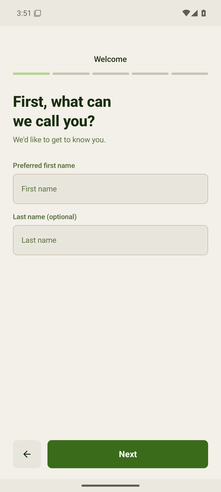 | **What you see.** A five-step welcome flow, shown by the progress bar at the top. Step one asks what to call you.<br><br>**How it works.** The flow collects the profile the rest of the app depends on: name, age, sex, height, weight, blood type, allergies, diet preference and daily calorie and water goals. When you finish, it creates the Firebase account, saves that profile to Firestore, and signs you in.<br><br>**Where.** `ui/auth/RegisterScreen.kt`, `ui/auth/AuthViewModel.kt` |

### Home

| | |
| --- | --- |
| 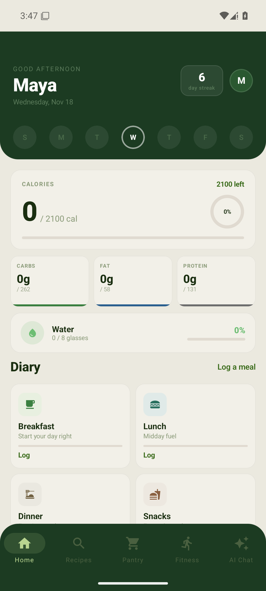 | **What you see.** A greeting, a **day streak** badge, the week as seven dots, today's **calories** against your goal, **carbs, fat and protein** tiles, a **water** tracker, and a **Diary** with Breakfast, Lunch, Dinner and Snacks cards.<br><br>**How it works.**<ul><li>The **streak** counts consecutive days, ending today, on which you logged calories. If today is still empty it counts back from yesterday, and it never shows less than 1.</li><li>The **calorie goal** comes from your profile. The macro goals are a fixed split of it: 25% protein, 50% carbs, 25% fat (so 2100 kcal becomes 131 g protein, 262 g carbs and 58 g fat).</li><li>The meal cards and **Log a meal** open the recipe list filtered to that meal. The avatar opens Settings; the water card opens the water tracker.</li></ul>**Where.** `ui/home/HomeScreen.kt` |
| 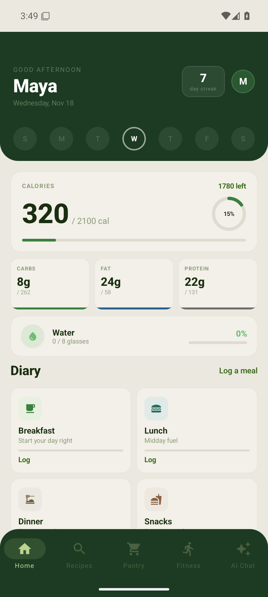 | **After logging a meal.** The same screen after logging one recipe: **320 / 2100 cal, 1780 left, 15%**, carbs 8 g, fat 24 g, protein 22 g, and the streak has risen from 6 to 7 because today now has a log. |

### Pantry

| | |
| --- | --- |
| 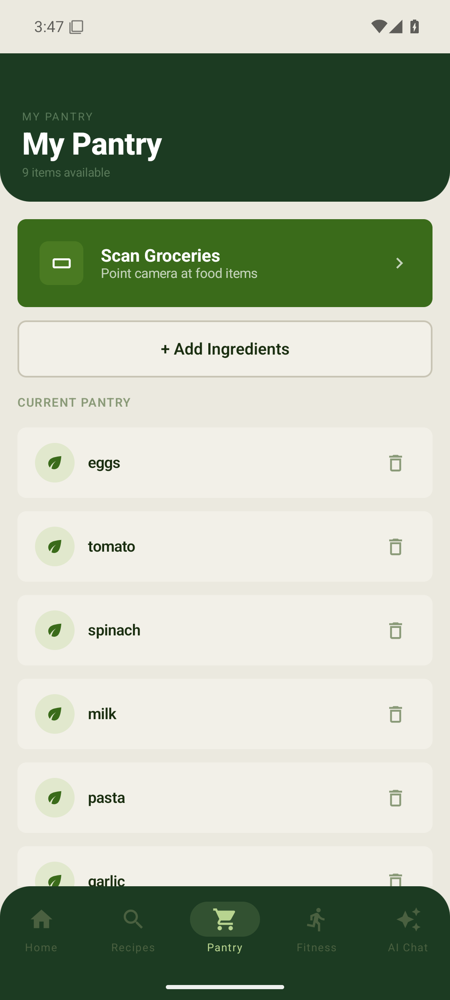 | **What you see.** A **Scan Groceries** button, an **Add Ingredients** button, and your current pantry as a list, each item with a delete icon. The header counts the items available.<br><br>**How it works.** The pantry lives in Firestore under your account. **Add Ingredients** searches as you type: after a short pause it asks Spoonacular's autocomplete for matching ingredient names. Items are stored with a name, quantity, unit and an availability flag, and only available items are listed.<br><br>Further down the screen is a **what can I make?** list built from your pantry (see [Recipes](#recipes)).<br><br>**Where.** `ui/pantry/PantryScreen.kt` |

### Scanning groceries

| | |
| --- | --- |
| 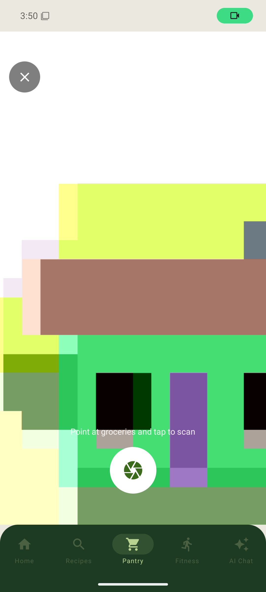 | **The camera.** **Scan Groceries** opens a live camera view (CameraX) with the prompt "Point at groceries and tap to scan" and a shutter button. The camera permission is requested the first time. In this screenshot the emulator's virtual camera is showing its synthetic test scene, not groceries. |
| 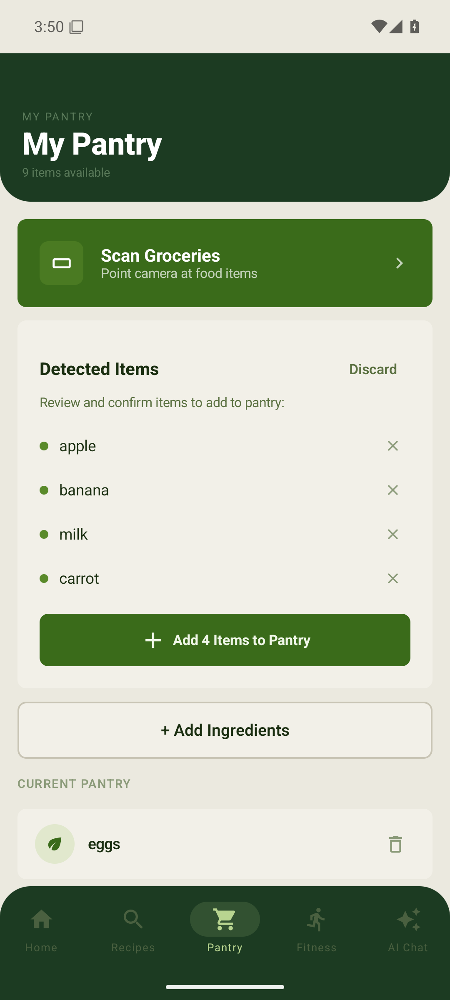 | **The result.** The photo is sent to OpenAI's vision model (`gpt-4o`, low detail) with a prompt asking for only the food items visible, one per line. The app cleans the reply (it strips bullets, drops sentence-like lines and keeps at most 10 items) and shows a **Detected Items** review list. You can remove anything wrong, then tap **Add items to Pantry**. Items already in the pantry are not added twice: in the test, banana and milk were already there, so only apple and carrot were added and the pantry went from 9 to 11. |

### Recipes

| | |
| --- | --- |
| 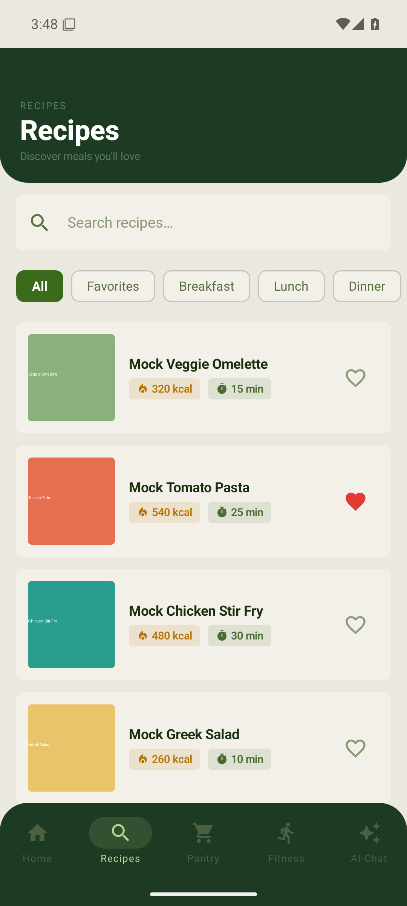 | **What you see.** A search box, filter chips (**All, Favorites, Breakfast, Lunch, Dinner, Snacks, Vegan, Keto**) and recipe cards showing an image, calories, cooking time and a heart for favourites.<br><br>**How it works.**<ul><li>Search goes to Spoonacular. Your **allergies** and **diet preference** from your profile are sent with every search, so results already respect them.</li><li>The meal chips add a meal type to the search. **Favorites** shows the recipes you have saved, loaded from your account rather than from Spoonacular.</li><li>The **what can I make?** list on the Pantry screen asks Spoonacular which recipes use the most of your pantry, then sorts them so the ones with the fewest missing ingredients come first.</li></ul>**Where.** `ui/recipe/RecipeSearchScreen.kt`, `repository/RecipeRepository.kt` |

### Recipe detail

| | |
| --- | --- |
| 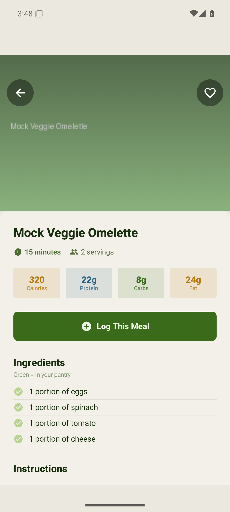 | **What you see.** The recipe title, time and servings, **calorie and macro tiles**, a **Log This Meal** button, the **ingredient list** with a green tick for everything already in your pantry, and the step-by-step instructions below.<br><br>**What you can do.**<ul><li>**Log This Meal** adds the recipe's calories and macros to today's diary entry.</li><li>The **heart** saves it to your favourites.</li><li>For missing ingredients, **Swap It** asks OpenAI (`gpt-4o-mini`) for two to four practical substitutes each.</li><li>**Order missing items** opens a search for those items in **Uber Eats, DoorDash, Instacart or Amazon Fresh**, and the shopping list can be shared as text.</li></ul>**Where.** `ui/recipe/RecipeDetailScreen.kt` |

### Fitness

| | |
| --- | --- |
| 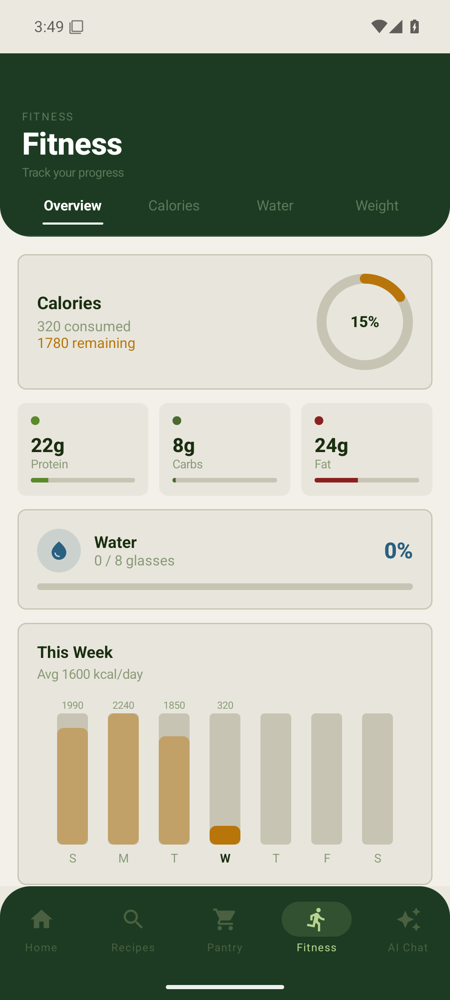 | **What you see.** Four tabs: **Overview, Calories, Water and Weight**. The Overview shows today's calories as a ring (320 consumed, 1780 remaining), the three macro tiles, water progress, and a **This Week** bar chart with the weekly average.<br><br>**How it works.** Everything is read from the daily logs in Firestore. The weekly chart plots each day's calories; the average is over the days of the week that have a log entry (in the screenshot: 1990, 2240, 1850 and 320, which average 1600 kcal a day). The Weight tab shows the weight from your profile in kilograms and pounds.<br><br>**Where.** `ui/fitness/FitnessScreen.kt`, `ui/water/WaterScreen.kt` |

### AI chat

| | |
| --- | --- |
| 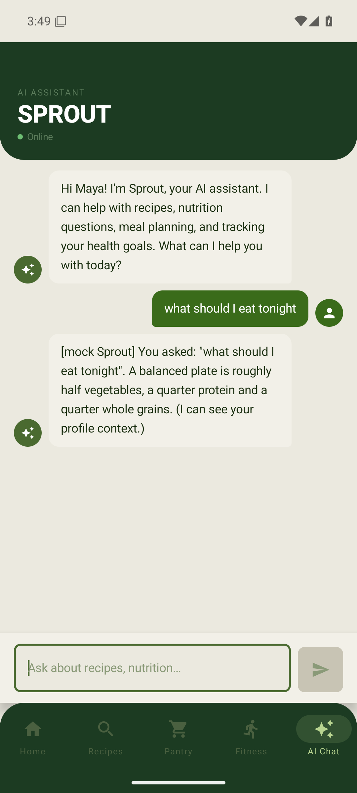 | **What you see.** A chat with **Sprout**, greeting you by first name.<br><br>**How it works.** Each conversation starts with a hidden system message that gives Sprout its job and its limits, followed by a summary of **your profile, your pantry and today's calories**. The whole message history is sent to OpenAI (`gpt-4o-mini`, capped at 600 tokens) on every turn so it can follow the conversation.<br><br>The system prompt confines Sprout to food, nutrition, cooking, pantry and wellness topics, tells it to refuse anything else, and tells it not to be talked out of that. Off-topic questions get a fixed polite refusal.<br><br>**Where.** `ui/chatbot/ChatbotScreen.kt`, `network/OpenAIClient.kt` |

### Settings

| | |
| --- | --- |
| 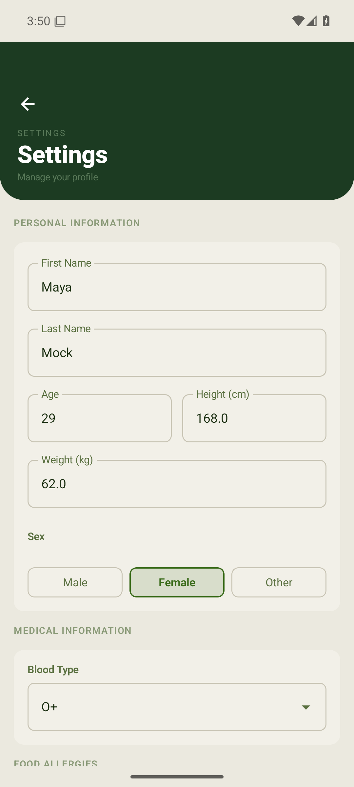 | **What you see.** Your profile, in sections: **Personal information** (name, age, height, weight, sex), **Medical information** (blood type), **Food allergies** (Gluten, Dairy, Nuts, Shellfish, Eggs, Soy, Fish, Wheat or None), **Diet preference** (None, Vegetarian, Vegan, Keto, Paleo, Gluten-Free, Mediterranean) and **Daily goals** (calories and water).<br><br>**How it works.** **Save Changes** writes the profile back to Firestore, and the changes immediately affect search filtering, the macro goals and what the chatbot knows. **Log Out** signs you out and returns to the sign-in screen.<br><br>**Where.** `ui/settings/SettingsScreen.kt` |

---

## 3. How the app is built

### Layers

Every screen follows the same pattern. A Compose **screen** draws the UI and reacts to state. A **ViewModel** holds that state and runs the logic. Repositories and clients do the talking to outside services.

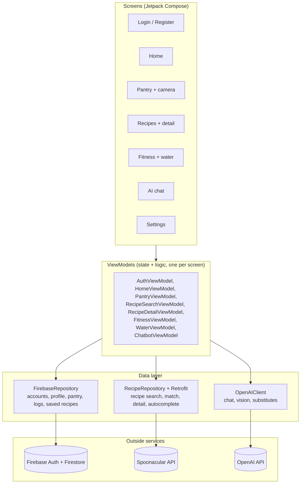

### Navigation

A single activity hosts a Navigation Compose graph. It always starts on a **splash** route that decides where to go once the saved sign-in has been checked. The bottom bar is hidden on the auth screens, the recipe detail and Settings.

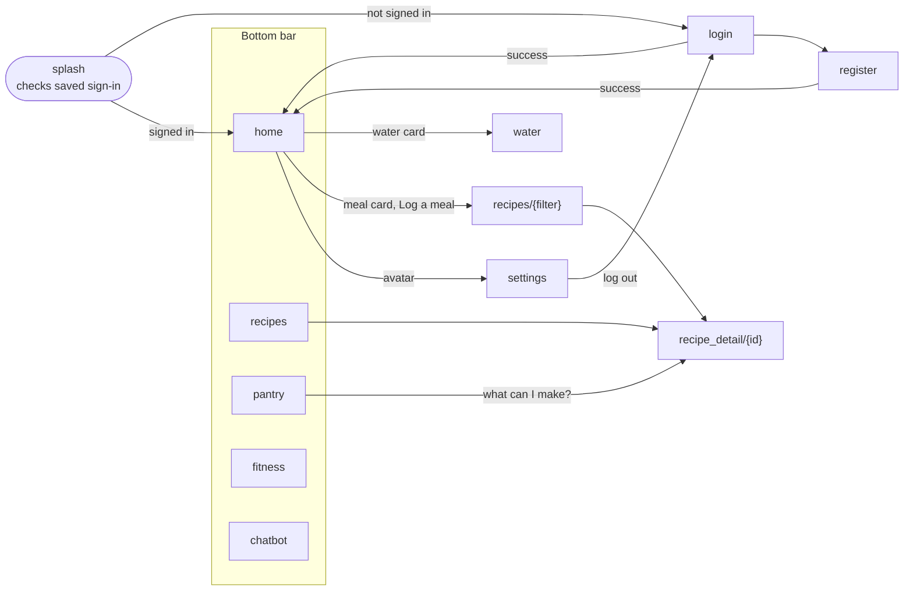

### Key flows

**Signing in.** The ViewModel signs in, then loads the profile; the screen only moves on when both succeed.

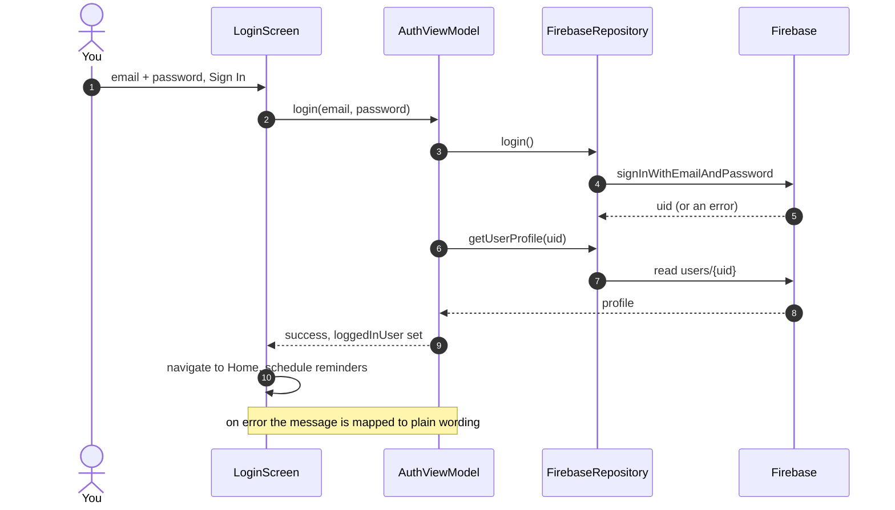

**Scanning groceries.**

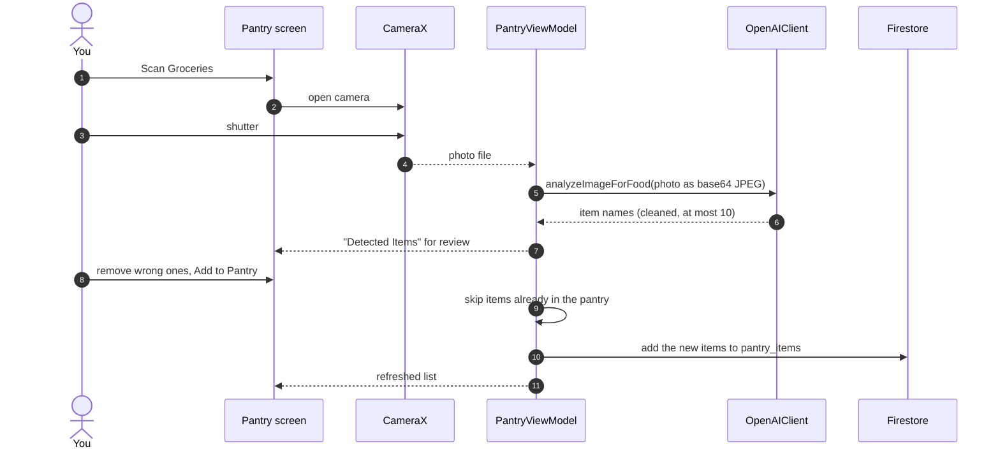

**From pantry to dinner.**

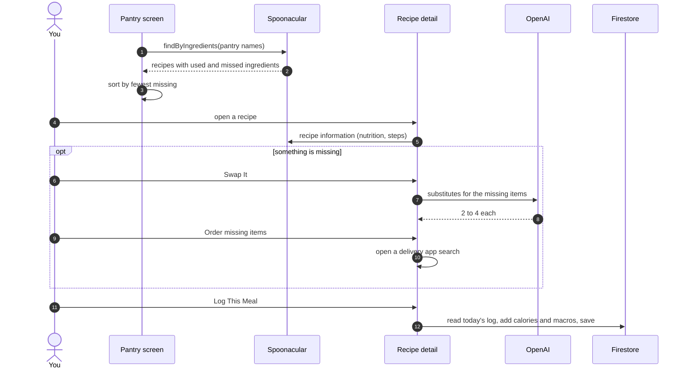

**Asking Sprout.**

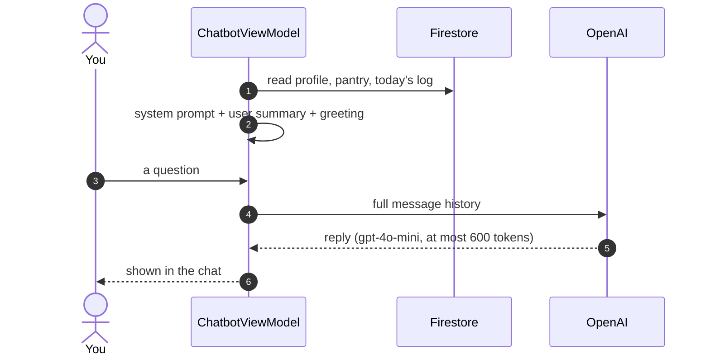

---

## 4. Data and external services

### Where your data lives

All of it is in Firestore, under your own user document. The app's models are plain Kotlin data classes.

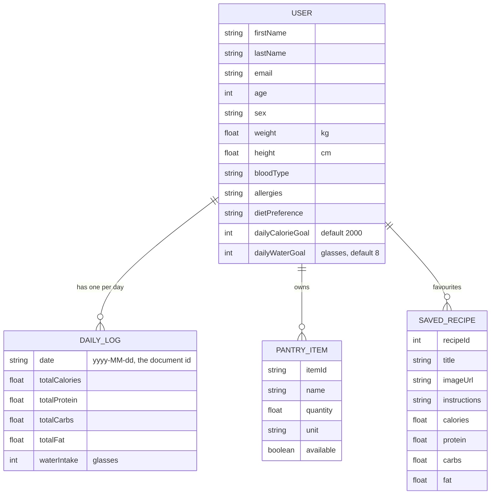

In Firestore these are `users/{uid}`, `users/{uid}/daily_logs/{date}`, `users/{uid}/pantry_items/{id}` and `users/{uid}/saved_recipes/{recipeId}`. Accounts themselves are in Firebase Authentication.

### The three outside services

| Service | Used for | Cost and limits |
| --- | --- | --- |
| **Firebase** (Auth and Firestore) | Accounts, profile, pantry, diary, saved recipes | Free plan is enough at this scale |
| **Spoonacular** | Recipe search, match by ingredients, recipe detail with nutrition, ingredient autocomplete | Free tier of about 150 points a day |
| **OpenAI** | Chat (`gpt-4o-mini`), camera recognition (`gpt-4o`), substitutes (`gpt-4o-mini`) | Pay per use |

Your Spoonacular and OpenAI keys are read from `local.properties` at build time and compiled into the app. Keys compiled into an APK can be extracted from it, so use restricted or low-quota keys for anything you share.

### What is sent where

- **To Spoonacular:** recipe and ingredient search text, plus your allergies and diet preference.
- **To OpenAI:** your chat messages together with a summary of your profile, pantry and today's calories; any grocery photo you scan; and the names of ingredients you are missing.
- **To Firebase:** your account and everything listed in the data model above.

---

## 5. Background work and reminders

The app uses Android WorkManager for three kinds of scheduled work.

| When | What | Notes |
| --- | --- | --- |
| 08:00 daily | "Breakfast time!" reminder | Meals notification channel |
| 12:00 daily | "Lunch break!" reminder | Meals notification channel |
| 18:00 daily | "Dinner time!" reminder | Meals notification channel |
| 22:00 daily | **Evening check** | Looks at today's log and reports, for example, calories more than 20% under goal or glasses of water still to drink. Health channel |
| Midnight | Creates an empty log for the new day if there isn't one | Re-schedules itself each night |

The reminders are scheduled when you sign in or register, and repeat every 24 hours. Android 13 and later asks for notification permission on first launch.

---

## 6. Tech stack

| Area | What is used |
| --- | --- |
| Language and UI | Kotlin 2.0.21, Jetpack Compose with Material 3 |
| Navigation and state | Navigation Compose, ViewModels with Kotlin Flows |
| Accounts and data | Firebase Authentication and Cloud Firestore |
| Networking | Retrofit and OkHttp (Spoonacular); plain OkHttp with JSON for OpenAI |
| Camera | CameraX |
| Background work | WorkManager |
| Images | Coil |
| Build | Android Gradle Plugin 8.9.1, Gradle 9.3.1, compile SDK 36, minimum SDK 26 (Android 8.0) |

---

## 7. Project layout

```
app/src/main/java/com/team8/smartfridge/
  MainActivity.kt            navigation graph, bottom bar, entry point
  data/
    FirebaseRepository.kt    every Firebase call: auth, profile, pantry, logs, saved recipes
  model/
    Entities.kt              User, DailyLog, PantryItem, SavedRecipe
  network/
    RetrofitInstance.kt      Spoonacular client setup
    SpoonacularApi.kt        the Spoonacular endpoints used
    SpoonacularModels.kt     response shapes
    OpenAIClient.kt          chat, vision and substitutes, plus the Sprout system prompt
  repository/
    RecipeRepository.kt      wraps the Spoonacular calls
  ui/
    auth/                    login, registration, AuthViewModel
    home/                    the diary and daily summary
    pantry/                  pantry list, camera scan, recipe match
    recipe/                  search, favourites, detail, swap and order sheets
    fitness/                 overview, calories, water, weight
    water/                   the water counter
    chatbot/                 Sprout
    settings/                profile editing
    theme/                   colours, type, theme
  utils/
    NotificationWorker.kt    the reminders
    RecipeMatchStore.kt      hands a match result to the detail screen
```

---

## 8. Running it yourself

The [README](../README.md) has the full setup. In short: Android Studio, your own Spoonacular and OpenAI keys in `local.properties`, and your own Firebase project with Email/Password sign-in and Firestore enabled (download its `google-services.json` into `app/`). Without the Firebase file the build fails; without the API keys the app builds but recipes and AI features fail at runtime.

---

## How this guide was verified

**The app was built and run.** A fresh clone of this repository was built with Gradle (a debug APK, plus its unit test, which passes) and installed on an emulator running Android 15.

**With mock backends.** To run without real accounts or keys, a scratch copy of the app was patched to use an in-memory stand-in for `FirebaseRepository` (a seeded account, pantry, daily logs and one saved recipe) and to send Spoonacular and OpenAI requests to local mock servers. The mock servers logged every request, which confirmed the app really made them. The patch was never committed.

**Exercised and working:** sign-in and sign-out, the wrong-password message, Home and its numbers, the Pantry list, the camera and the scan review, adding scanned items without duplicates, recipe search and cards, favourites state, recipe detail, **Log This Meal** (Home and Fitness updated correctly afterwards), the Fitness overview, AI chat, Settings, and the first step of the registration flow. No crashes occurred during any of it.

**Not exercised:** the real Firebase, Spoonacular and OpenAI services (so real Firestore security rules, real search quality and real image recognition are untested); completing registration; password reset; saving Settings; the water counter and the other Fitness tabs; Swap It and the delivery-app links; the **what can I make?** list on the Pantry screen; and the scheduled notifications.

---

## 10. Limits and rough edges

Things worth knowing, found while reading the code:

- **Search failures look like "no results".** `RecipeRepository` catches every network error and returns an empty list. If the Spoonacular daily limit runs out or the network drops, the app shows "No recipes found" instead of explaining why.
- **Macro goals are one fixed split.** They are always 25% protein, 50% carbs and 25% fat of the calorie goal, regardless of diet, so a keto user sees carb targets that do not fit their diet.
- **The Weight tab is a stub.** It shows the profile weight in kg and lb, but its "Change" figure is a placeholder dash; weight is not tracked over time.
- **API keys ship inside the APK.** See [section 4](#4-data-and-external-services).
- **Reminders start after sign-in.** They are scheduled at sign-in or registration, not at every app launch.
